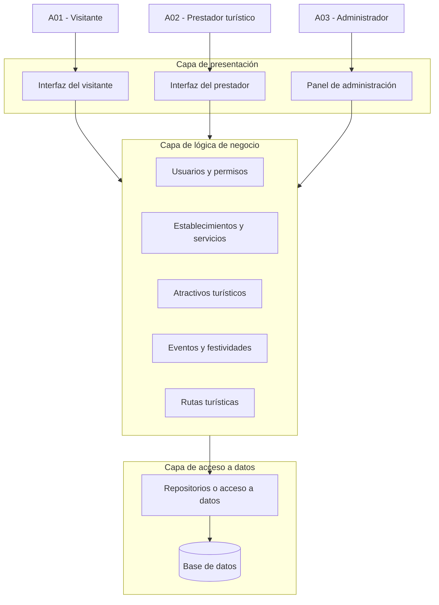

# Arquitectura Inicial

## Sistema Integral de Gestión Turística de Huamanga

### 1. Propósito

Este documento presenta la propuesta inicial de arquitectura del Sistema Integral de Gestión Turística de Huamanga. Su finalidad es definir la organización general del sistema, las responsabilidades de sus capas y las relaciones entre sus principales componentes.

La arquitectura se plantea a partir de los requisitos funcionales, los atributos de calidad, las restricciones y los drivers arquitectónicos identificados durante el análisis del sistema. Las tecnologías específicas se definirán posteriormente.

### 2. Organización general

Se propone organizar el sistema mediante una arquitectura en tres capas:

- **Capa de presentación:** permite la interacción de los usuarios con el sistema.
- **Capa de lógica de negocio:** procesa las operaciones y aplica las reglas del sistema.
- **Capa de acceso a datos:** gestiona la consulta, el almacenamiento y la actualización de la información persistente.

Cada capa tendrá responsabilidades definidas para facilitar la organización, el mantenimiento y la evolución del sistema.

### 3. Capa de presentación

Esta capa será responsable de recibir las solicitudes de los usuarios y mostrar los resultados generados por el sistema.

**Responsabilidades:**

- Mostrar información sobre atractivos, servicios, eventos y rutas turísticas.
- Permitir la búsqueda y consulta de información turística.
- Proporcionar interfaces para que los prestadores turísticos gestionen sus servicios.
- Proporcionar una interfaz de administración para gestionar la información y los usuarios.
- Enviar las solicitudes a la capa de lógica de negocio y presentar las respuestas recibidas.

**Componentes propuestos:**

- Interfaz web para visitantes.
- Interfaz de gestión para prestadores turísticos.
- Panel de administración.
- Mecanismo de comunicación con la lógica de negocio.

### 4. Capa de lógica de negocio

Esta capa procesará las operaciones del sistema y aplicará las reglas necesarias para mantener la coherencia de la información y controlar las acciones permitidas.

**Responsabilidades:**

- Gestionar usuarios y permisos.
- Gestionar establecimientos y servicios turísticos.
- Gestionar atractivos turísticos.
- Gestionar eventos y festividades.
- Gestionar rutas turísticas.
- Procesar búsquedas y consultas.
- Validar los datos recibidos.
- Verificar los permisos antes de ejecutar operaciones restringidas.
- Coordinar las operaciones de consulta y actualización de datos.

**Módulos propuestos:**

- Módulo de usuarios y permisos.
- Módulo de establecimientos.
- Módulo de servicios turísticos.
- Módulo de atractivos turísticos.
- Módulo de eventos y festividades.
- Módulo de rutas turísticas.

La organización interna definitiva de estos módulos se detallará durante el diseño del software.

### 5. Capa de acceso a datos

Esta capa será responsable de gestionar el acceso a la información persistente del sistema.

**Responsabilidades:**

- Consultar y almacenar información de usuarios.
- Gestionar los datos de establecimientos y servicios turísticos.
- Gestionar los datos de atractivos, eventos y rutas.
- Ejecutar las operaciones de creación, consulta, actualización y eliminación que correspondan.
- Contribuir a mantener la integridad y consistencia de la información.

**Componentes propuestos:**

- Repositorios o componentes de acceso a datos.
- Base de datos.

La tecnología y el modelo de base de datos se definirán en una etapa posterior. La capa de presentación no accederá directamente a la base de datos; las operaciones se realizarán mediante la lógica de negocio y los componentes de acceso a datos.

### 6. Flujo de comunicación

El flujo general de una solicitud seguirá esta secuencia:

1. El usuario realiza una consulta o solicita una operación desde la interfaz.
2. La capa de presentación envía la solicitud a la lógica de negocio.
3. La lógica de negocio valida la información y los permisos cuando corresponda.
4. Si la operación requiere datos persistentes, la lógica de negocio coordina el acceso a través de los componentes de datos.
5. La respuesta se devuelve a la capa de presentación para mostrarse al usuario.

Este flujo representa la organización lógica propuesta; los mecanismos técnicos de comunicación se definirán posteriormente.

### 7. Diagrama de arquitectura inicial

**Nota:** el diagrama representa las capas y los módulos propuestos. Los módulos se muestran agrupados en la capa de lógica de negocio para simplificar la vista general. Las relaciones internas se precisarán en el modelo de componentes.

### 8. Relación con los drivers arquitectónicos

La propuesta inicial considera los siguientes drivers:

- **DA01 — Organización de la arquitectura:** orienta la separación en tres capas.
- **DA02 — Rendimiento:** considera los tiempos de respuesta de las consultas.
- **DA03 — Escalabilidad:** contempla el posible aumento de usuarios y solicitudes.
- **DA04 — Seguridad:** orienta el control de permisos y la protección de la información.
- **DA05 — Persistencia de datos:** establece la necesidad de almacenar y recuperar información.
- **DA06 — Mantenibilidad:** orienta la separación de responsabilidades y la organización de los módulos.

La arquitectura propuesta deberá evaluarse durante el desarrollo mediante los requisitos y escenarios de calidad definidos en el análisis del sistema.

### 9. Consideraciones y aspectos pendientes

La arquitectura descrita constituye una propuesta inicial y no representa todavía una implementación definitiva. Quedan pendientes:

- Seleccionar las tecnologías de desarrollo.
- Definir el mecanismo de comunicación entre la presentación y la lógica de negocio.
- Precisar el modelo de datos.
- Detallar las interfaces y responsabilidades de cada componente.
- Verificar el cumplimiento de los escenarios de calidad.

### 10. Conclusión

La arquitectura inicial en tres capas proporciona una estructura para organizar el Sistema Integral de Gestión Turística de Huamanga. La separación entre presentación, lógica de negocio y acceso a datos permitirá definir las responsabilidades de los componentes y servirá como base para desarrollar los diagramas arquitectónicos y el diseño interno del sistema.
