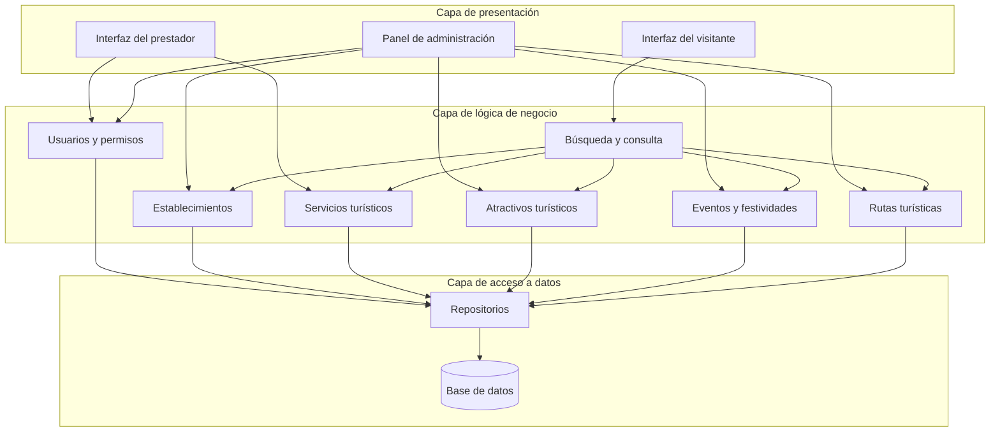

# Componentes Arquitectónicos

## Sistema Integral de Gestión Turística de Huamanga

### 1. Propósito

Este documento identifica los principales componentes arquitectónicos propuestos para el Sistema Integral de Gestión Turística de Huamanga. Describe sus responsabilidades, las operaciones que realizan y sus relaciones con otros componentes.

La definición se basa en los requisitos funcionales, los drivers arquitectónicos y la arquitectura inicial del sistema. Los componentes son una propuesta de diseño que podrá ajustarse durante la implementación.

### 2. Componentes de la capa de presentación

#### 2.1. Interfaz del visitante

**Responsabilidad:** permitir que los visitantes consulten información turística.

**Operaciones principales:**
- Consultar atractivos turísticos.
- Buscar servicios turísticos.
- Consultar eventos y festividades.
- Consultar rutas turísticas.
- Visualizar el detalle de los servicios disponibles.

**Dependencias:** componentes de búsqueda y consulta de la lógica de negocio.

#### 2.2. Interfaz del prestador turístico

**Responsabilidad:** proporcionar las funciones de gestión que correspondan a los prestadores turísticos autorizados.

**Operaciones principales:**
- Registrar información de servicios turísticos.
- Actualizar la información de sus servicios.

**Dependencias:** componentes de autenticación, autorización y gestión de servicios.

#### 2.3. Panel de administración

**Responsabilidad:** proporcionar las funciones administrativas del sistema.

**Operaciones principales:**
- Gestionar usuarios.
- Gestionar establecimientos turísticos.
- Gestionar atractivos turísticos.
- Gestionar eventos y festividades.
- Gestionar rutas turísticas.

**Dependencias:** componentes de seguridad y módulos de gestión de la lógica de negocio.

### 3. Componentes de la capa de lógica de negocio

#### 3.1. Componente de usuarios y permisos

**Responsabilidad:** gestionar las operaciones relacionadas con los usuarios y sus permisos.

**Operaciones principales:**
- Gestionar las cuentas de usuario.
- Verificar la identidad del usuario cuando la operación lo requiera.
- Comprobar los permisos asociados a su rol.
- Restringir las operaciones administrativas a los usuarios autorizados.

#### 3.2. Componente de establecimientos

**Responsabilidad:** gestionar la información de los establecimientos turísticos.

**Operaciones principales:**
- Registrar y actualizar establecimientos.
- Consultar información de establecimientos.
- Validar los datos antes de guardarlos.

#### 3.3. Componente de servicios turísticos

**Responsabilidad:** gestionar la información de los servicios turísticos ofrecidos por los establecimientos o prestadores correspondientes.

**Operaciones principales:**
- Registrar servicios turísticos.
- Actualizar información de los servicios.
- Consultar servicios disponibles.
- Validar los datos recibidos.

#### 3.4. Componente de atractivos turísticos

**Responsabilidad:** gestionar la información de los lugares de interés turístico de Huamanga.

**Operaciones principales:**
- Registrar y actualizar atractivos turísticos.
- Consultar y buscar atractivos.
- Validar la información antes de almacenarla.

#### 3.5. Componente de eventos y festividades

**Responsabilidad:** gestionar la información de eventos y festividades de interés turístico.

**Operaciones principales:**
- Registrar y actualizar eventos.
- Consultar eventos y festividades.
- Mantener la información correspondiente a las fechas y descripciones de los eventos.

#### 3.6. Componente de rutas turísticas

**Responsabilidad:** gestionar la información de las rutas turísticas disponibles.

**Operaciones principales:**
- Registrar y actualizar rutas.
- Consultar rutas.
- Mantener la información descriptiva necesaria para su consulta.

#### 3.7. Componente de búsqueda y consulta

**Responsabilidad:** procesar las solicitudes de búsqueda y consulta de información turística.

**Operaciones principales:**
- Consultar atractivos, servicios, eventos y rutas.
- Aplicar los criterios de búsqueda definidos para cada funcionalidad.
- Preparar los resultados que se devolverán a la capa de presentación.

Este componente podrá reutilizar las operaciones de consulta de los módulos correspondientes para evitar duplicar reglas de negocio.

### 4. Componentes de la capa de acceso a datos

#### 4.1. Repositorios o componentes de acceso a datos

**Responsabilidad:** proporcionar a la lógica de negocio operaciones para consultar y modificar la información persistente.

**Operaciones principales:**
- Recuperar información almacenada.
- Registrar nuevos datos.
- Actualizar información existente.
- Eliminar registros cuando la operación esté autorizada y corresponda a las reglas del sistema.

Los repositorios separarán las operaciones de negocio de los detalles específicos de almacenamiento.

#### 4.2. Base de datos

**Responsabilidad:** almacenar la información persistente utilizada por el sistema.

**Información principal:**
- Usuarios y roles.
- Establecimientos y servicios turísticos.
- Atractivos turísticos.
- Eventos y festividades.
- Rutas turísticas.

El modelo de datos, las relaciones entre entidades y el gestor de base de datos se definirán en una etapa posterior.

### 5. Relaciones y dependencias entre componentes

Las relaciones principales propuestas son las siguientes:

1. Las interfaces reciben las solicitudes de los usuarios y las envían a la lógica de negocio.
2. El componente de usuarios y permisos verifica las autorizaciones necesarias para las operaciones restringidas.
3. Los módulos de gestión procesan las operaciones relacionadas con la información turística.
4. El componente de búsqueda y consulta coordina las consultas solicitadas por los visitantes.
5. Los componentes de negocio utilizan los repositorios para acceder a la información persistente.
6. Los repositorios se comunican con la base de datos para recuperar o modificar los registros.
7. Los resultados se devuelven a la capa de presentación para mostrarse al usuario.

Las interfaces no accederán directamente a la base de datos.

### 6. Diagrama de componentes propuesto

**Nota:** el diagrama representa dependencias lógicas propuestas. No especifica protocolos, tecnologías ni interfaces de programación definitivas. Los mecanismos de autorización deberán aplicarse a todas las operaciones que lo requieran, independientemente de la interfaz desde la que se soliciten.

### 7. Relación con los requisitos funcionales

Los componentes se relacionan con los requisitos funcionales de la siguiente manera:

| Requisitos | Componentes principales |
|---|---|
| RF01–RF05 | Búsqueda y consulta; módulos de servicios, atractivos, eventos y rutas. |
| RF06–RF07 | Usuarios y permisos; servicios turísticos. |
| RF08–RF12 | Usuarios y permisos; módulos de gestión de establecimientos, atractivos, eventos y rutas. |

Esta relación es preliminar y deberá contrastarse con la descripción definitiva de cada requisito funcional para asegurar la trazabilidad completa.

### 8. Consideraciones pendientes

Antes de implementar los componentes, será necesario:

- Definir las interfaces entre los componentes.
- Precisar las operaciones y los datos de entrada y salida.
- Definir el modelo de datos.
- Seleccionar las tecnologías de desarrollo y almacenamiento.
- Establecer cómo se aplicarán la autenticación y la autorización.
- Verificar las relaciones mediante el diseño detallado y las pruebas.

### 9. Conclusión

La identificación de los componentes arquitectónicos permite organizar las funcionalidades del Sistema Integral de Gestión Turística de Huamanga y definir sus principales responsabilidades. Esta propuesta servirá como base para elaborar los diagramas C4 y avanzar hacia el diseño interno del software.
