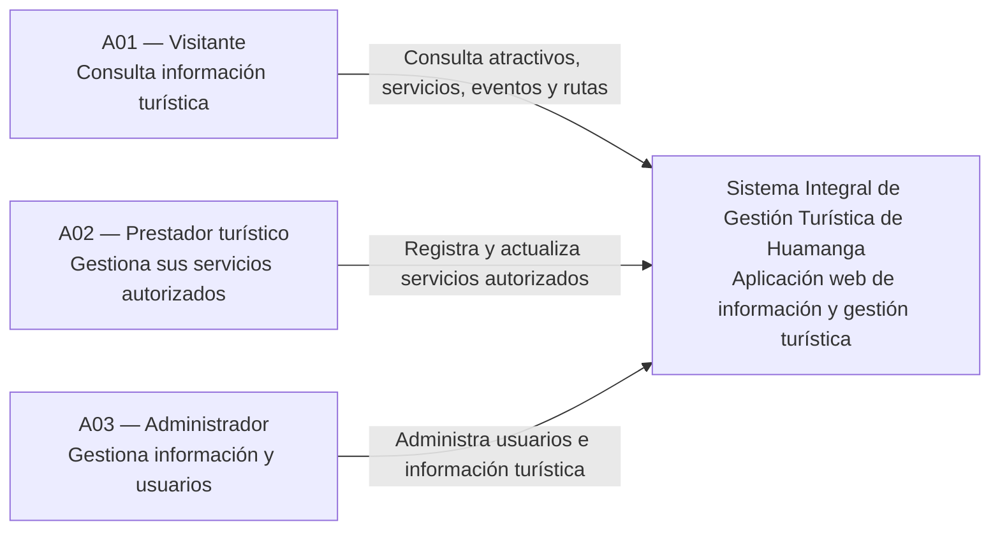

# Nivel 1 — Diagrama de Contexto del Sistema

## Sistema Integral de Gestión Turística de Huamanga

### 1. Objetivo

Representar el Sistema Integral de Gestión Turística de Huamanga en su entorno, identificando a los actores que interactúan con él y las principales relaciones entre ellos.

Este diagrama corresponde al Nivel 1 del modelo C4 y presenta una visión general del sistema sin detallar su estructura interna.

### 2. Actores del sistema

- **A01 — Visitante:** consulta información sobre atractivos, servicios, eventos, festividades y rutas turísticas.
- **A02 — Prestador turístico:** registra y actualiza la información de los servicios turísticos que tiene autorización para gestionar.
- **A03 — Administrador:** gestiona y supervisa la información turística y los usuarios del sistema de acuerdo con sus permisos.

### 3. Sistema principal

**Sistema Integral de Gestión Turística de Huamanga**

Aplicación propuesta para centralizar y facilitar la consulta y gestión de información turística de Huamanga, de acuerdo con las funcionalidades y permisos definidos para cada tipo de usuario.

### 4. Diagrama de contexto

### 5. Descripción de las relaciones

- El visitante utiliza el sistema para consultar la información turística disponible.
- El prestador turístico utiliza las funcionalidades autorizadas para registrar o actualizar sus servicios.
- El administrador utiliza las funciones de gestión de usuarios y de información turística según sus permisos.

Las flechas representan las interacciones principales de los actores con el sistema. Los mecanismos técnicos de comunicación se definirán posteriormente.

### 6. Alcance y consideraciones

El diagrama no incluye sistemas externos porque, hasta el momento, no se han identificado integraciones confirmadas para el proyecto. Si posteriormente se decide integrar servicios de mapas, notificaciones u otros sistemas, estos deberán incorporarse al diagrama cuando corresponda.

La aplicación web es una propuesta de solución. Su tecnología de implementación todavía está pendiente de selección.

### 7. Conclusión

El diagrama de contexto permite comprender el alcance general del Sistema Integral de Gestión Turística de Huamanga y las principales interacciones con sus actores. Servirá como punto de partida para detallar los contenedores y componentes internos en los siguientes niveles del modelo C4.
