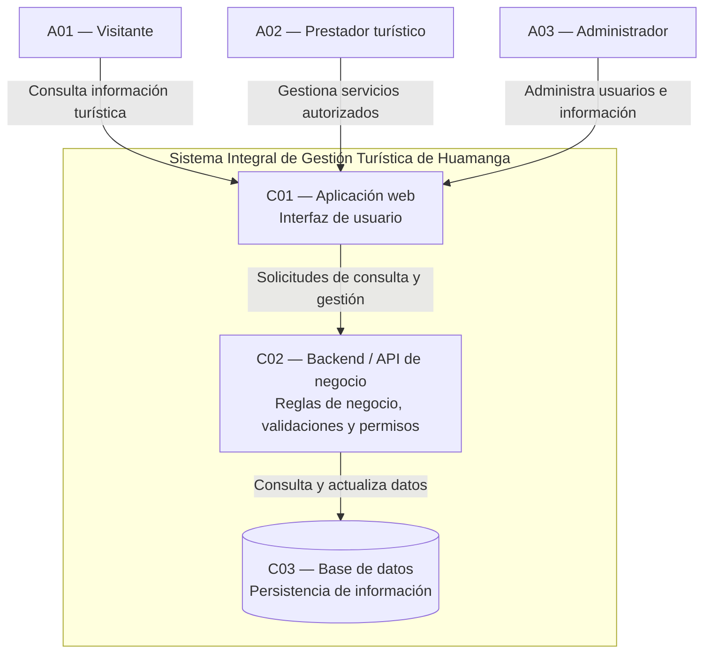

# Nivel 2 — Diagrama de Contenedores

## Sistema Integral de Gestión Turística de Huamanga

### 1. Objetivo

Representar la estructura general del Sistema Integral de Gestión Turística de Huamanga, identificando sus principales contenedores, las responsabilidades de cada uno y las relaciones que mantienen entre sí.

En el modelo C4, un contenedor representa una aplicación o un almacén de datos que forma parte del sistema. No necesariamente se refiere a un contenedor Docker.

### 2. Contenedores propuestos

**C01 — Aplicación web**

Interfaz mediante la cual los visitantes consultan información turística, los prestadores turísticos gestionan sus servicios autorizados y los administradores realizan las tareas de gestión que les corresponden.

- **Responsabilidad:** presentar la información y permitir la interacción de los usuarios.
- **Tecnología:** por definir.

**C02 — Backend o API de negocio**

Procesa las solicitudes recibidas desde la aplicación web y ejecuta las reglas de negocio del sistema.

- **Responsabilidad:** validar los datos, controlar los permisos y gestionar las operaciones relacionadas con usuarios, establecimientos, servicios, atractivos, eventos, festividades y rutas turísticas.
- **Tecnología:** por definir.

**C03 — Base de datos**

Almacena la información necesaria para el funcionamiento del sistema.

- **Responsabilidad:** conservar y permitir la consulta y actualización de los datos de usuarios, establecimientos, servicios turísticos, atractivos, eventos, festividades y rutas.
- **Tecnología:** por definir.

### 3. Diagrama de contenedores

### 4. Descripción de las relaciones

- **Visitante → Aplicación web:** consulta atractivos turísticos, servicios, eventos, festividades y rutas.
- **Prestador turístico → Aplicación web:** registra o actualiza los servicios que tiene autorización para gestionar.
- **Administrador → Aplicación web:** administra usuarios e información turística de acuerdo con sus permisos.
- **Aplicación web → Backend:** envía las solicitudes necesarias para consultar o gestionar información.
- **Backend → Base de datos:** consulta, registra, modifica y recupera los datos según las operaciones solicitadas.

### 5. Relación con la arquitectura propuesta

Los contenedores se relacionan con las tres capas definidas en la arquitectura inicial:

| Capa arquitectónica | Contenedor relacionado | Responsabilidad |
|---|---|---|
| Presentación | Aplicación web | Interacción con los usuarios. |
| Lógica de negocio | Backend o API | Reglas, validaciones y permisos. |
| Acceso a datos | Backend y base de datos | Acceso controlado y persistencia de información. |

El acceso a la base de datos deberá realizarse mediante mecanismos definidos en la implementación, evitando que la interfaz web acceda directamente a ella.

### 6. Tecnologías pendientes de definición

Las tecnologías de implementación todavía no se han seleccionado. Antes de cerrar este diseño, se deberá determinar:

- La tecnología para desarrollar la aplicación web.
- La tecnología para implementar la lógica de negocio y la API.
- El sistema gestor de base de datos.
- El protocolo de comunicación y las medidas de seguridad.
- La forma de despliegue de la solución.

**Nota de diseño:** este diagrama supone que la aplicación web y el backend se implementarán como contenedores separados. Si se decide desarrollar una aplicación monolítica en la que ambos formen una sola unidad desplegable, el diagrama deberá ajustarse.

### 7. Conclusión

El diagrama de contenedores presenta una propuesta inicial para organizar el sistema turístico en una interfaz web, un componente de lógica de negocio y una base de datos. Esta separación busca facilitar el mantenimiento, el control de acceso y la gestión de la información. La estructura y las tecnologías deberán confirmarse antes de iniciar la implementación.