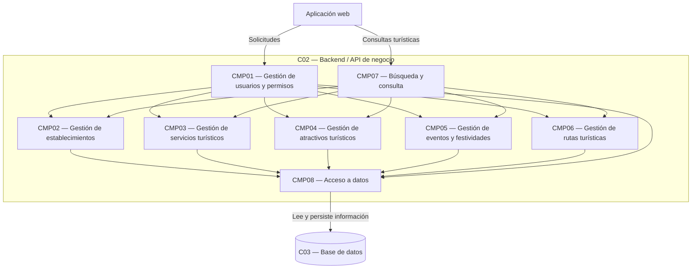

# Nivel 3 — Diagrama de Componentes

## Sistema Integral de Gestión Turística de Huamanga

### 1. Objetivo

Representar los principales componentes internos del backend del Sistema Integral de Gestión Turística de Huamanga, identificando sus responsabilidades y las relaciones entre ellos.

Este diagrama amplía el contenedor Backend o API de negocio definido en el Nivel 2 del modelo C4.

### 2. Componentes propuestos

**CMP01 — Gestión de usuarios y permisos**

Administra las cuentas de usuario y verifica los permisos correspondientes a visitantes, prestadores turísticos y administradores.

**CMP02 — Gestión de establecimientos**

Permite administrar la información general de los establecimientos turísticos registrados en el sistema.

**CMP03 — Gestión de servicios turísticos**

Gestiona el registro, la consulta y la actualización de los servicios turísticos, respetando los permisos establecidos.

**CMP04 — Gestión de atractivos turísticos**

Administra la información de los atractivos turísticos de Huamanga para facilitar su consulta por los visitantes.

**CMP05 — Gestión de eventos y festividades**

Gestiona la información de eventos y festividades turísticas, incluyendo sus datos descriptivos y fechas cuando corresponda.

**CMP06 — Gestión de rutas turísticas**

Administra la información de las rutas turísticas disponibles para su consulta.

**CMP07 — Búsqueda y consulta**

Organiza las operaciones de búsqueda y consulta de información turística para la aplicación web.

**CMP08 — Acceso a datos**

Centraliza las operaciones de acceso y persistencia de la información, comunicándose con la base de datos.

### 3. Diagrama de componentes

### 4. Descripción de las relaciones

- **Aplicación web:** envía solicitudes al backend para consultar o gestionar información.
- **Gestión de usuarios y permisos:** verifica las autorizaciones antes de ejecutar operaciones protegidas.
- **Gestión de establecimientos, servicios, atractivos, eventos y rutas:** procesa las operaciones relacionadas con cada tipo de información turística.
- **Búsqueda y consulta:** coordina las consultas solicitadas desde la interfaz web.
- **Acceso a datos:** centraliza las operaciones necesarias para guardar, actualizar y recuperar información.
- **Base de datos:** conserva los datos gestionados por el sistema.

Las relaciones mostradas representan una propuesta lógica. La implementación deberá definir los mecanismos concretos de autenticación, autorización y comunicación entre componentes.

### 5. Relación con los requisitos funcionales

Los componentes se vinculan con los requisitos funcionales del sistema:

| Componente | Funcionalidades relacionadas |
|---|---|
| Gestión de usuarios y permisos | Administración de usuarios y control de acceso. |
| Gestión de establecimientos | Registro y administración de establecimientos turísticos. |
| Gestión de servicios turísticos | Registro, actualización y consulta de servicios. |
| Gestión de atractivos turísticos | Administración y consulta de atractivos. |
| Gestión de eventos y festividades | Registro y consulta de eventos y festividades. |
| Gestión de rutas turísticas | Administración y consulta de rutas. |
| Búsqueda y consulta | Búsqueda y visualización de información turística. |
| Acceso a datos | Persistencia de la información utilizada por los demás componentes. |

La correspondencia exacta con los requisitos RF01–RF12 deberá verificarse con el documento de requisitos funcionales del proyecto.

### 6. Consideraciones de diseño

- Cada componente debe tener una responsabilidad claramente definida.
- Los componentes deben evitar duplicar reglas de negocio.
- Las operaciones protegidas deben comprobar los permisos del usuario.
- El acceso a la base de datos debe mantenerse separado de la interfaz web.
- La organización propuesta puede ajustarse cuando se definan las tecnologías y los detalles de implementación.

Los componentes descritos son módulos lógicos propuestos; no implican necesariamente que cada uno se despliegue como un servicio independiente.

### 7. Conclusión

El diagrama de componentes muestra una posible organización interna del backend, separando las responsabilidades de gestión turística, búsqueda, permisos y acceso a datos. Esta organización busca facilitar el mantenimiento y la evolución del sistema, y deberá validarse con los requisitos funcionales definitivos.