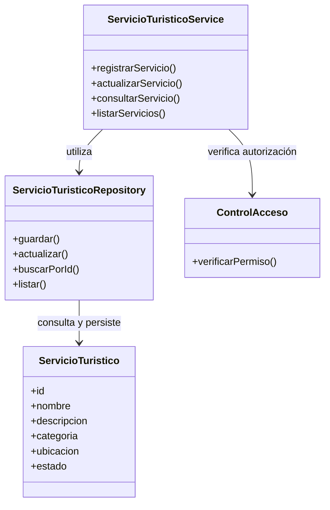

# Nivel 4 — Diagrama de Código

## Sistema Integral de Gestión Turística de Huamanga

### 1. Objetivo

Representar una propuesta de la estructura interna del código del Sistema Integral de Gestión Turística de Huamanga, utilizando clases y relaciones para explicar cómo podrían organizarse las responsabilidades de gestión turística.

Este diagrama complementa los niveles anteriores del modelo C4. Debido a que todavía no se han definido las tecnologías ni se ha implementado el sistema, las clases presentadas son referenciales.

### 2. Componente seleccionado

Para este nivel se toma como ejemplo el componente **CMP03 — Gestión de servicios turísticos**, definido en el Nivel 3.

Este componente se encarga de registrar, consultar y actualizar los servicios turísticos, considerando las validaciones y los permisos correspondientes.

### 3. Clases propuestas

**ServicioTuristico**

Representa un servicio turístico registrado en el sistema. Puede contener atributos como identificador, nombre, descripción, categoría, ubicación y estado.

**ServicioTuristicoService**

Contiene las operaciones y reglas de negocio relacionadas con los servicios turísticos, como registrar, actualizar y consultar información.

**ServicioTuristicoRepository**

Define las operaciones necesarias para acceder a los datos de los servicios turísticos, manteniendo separado el acceso a datos de las reglas de negocio.

**ControlAcceso**

Representa la responsabilidad de comprobar que el usuario tenga los permisos necesarios para realizar operaciones protegidas. Su implementación concreta dependerá del mecanismo de autenticación y autorización seleccionado.

### 4. Diagrama conceptual de clases

### 5. Descripción de las relaciones

- **ServicioTuristico:** representa los datos principales de un servicio turístico.
- **ServicioTuristicoService:** coordina las operaciones y aplica las reglas de negocio.
- **ServicioTuristicoRepository:** separa las operaciones de persistencia del resto de la lógica.
- **ControlAcceso:** permite verificar las autorizaciones necesarias antes de ejecutar operaciones protegidas.

Las flechas representan dependencias conceptuales, no una implementación confirmada.

### 6. Consideraciones de diseño

- Las clases deben mantener responsabilidades claras.
- Las reglas de negocio deben estar separadas del acceso a datos.
- Los datos recibidos deben validarse antes de guardarse.
- Las operaciones de registro y actualización deben respetar los permisos establecidos.
- Los atributos, métodos, tipos de datos y relaciones definitivas se determinarán al elegir el lenguaje y diseñar la implementación.

### 7. Limitaciones

Este diagrama no representa el código fuente real del sistema, porque todavía no se ha implementado. Tampoco define tipos de datos, visibilidad detallada, constructores ni relaciones de herencia definitivas.

Cuando se seleccione el lenguaje de programación, se podrá elaborar un diagrama de clases más preciso y coherente con el código.

### 8. Conclusión

El diagrama conceptual permite comprender cómo podrían organizarse las clases del componente de gestión de servicios turísticos. Su propósito es orientar el diseño interno y mantener separadas las responsabilidades, sin anticipar decisiones tecnológicas que aún están pendientes.